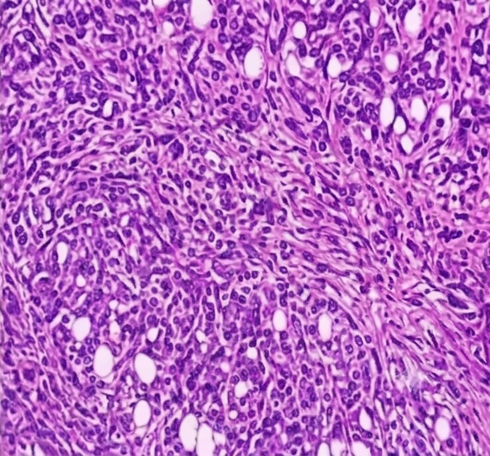
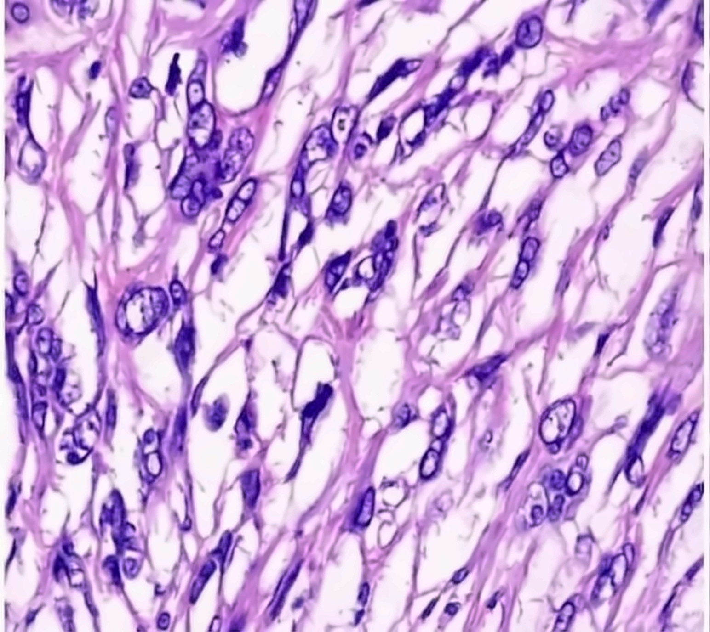

<p align="center">
  
</p>

<h1 align="center">MammoCare</h1>

<p align="center">
  <strong>Reproducible research in breast histopathology image classification.</strong><br>
  <sub>Auditable data preparation. Group-aware evaluation. Evidence-led experiments.</sub>
</p>

<p align="center">
  <a href="https://github.com/aryanap07">Aryan Patel</a>
  &nbsp;·&nbsp;
  <a href="https://github.com/Kumkumpathare">Kumkum Pathare</a>
</p>

<p align="center">
  <a href="LICENSE"></a>
  <a href="https://www.python.org/"></a>
  <a href="https://pytorch.org/"></a>
  
</p>

<p align="center">
  
  <em>
    MammoCare researchers studying breast histopathology images in a biomedical research laboratory
  </em>
</p>

<p align="center">
  <a href="#research-focus">Research Focus</a> &nbsp;·&nbsp;
  <a href="#dataset">Dataset</a> &nbsp;·&nbsp;
  <a href="#methodology">Methodology</a> &nbsp;·&nbsp;
  <a href="#baseline-results">Baseline Results</a> &nbsp;·&nbsp;
  <a href="#getting-started">Getting Started</a> &nbsp;·&nbsp;
  <a href="#research-plan">Research Plan</a>
</p>

---

## Research Focus

MammoCare is a research repository exploring how machine-learning models distinguish **benign** from **malignant** breast histopathology images in the BreaKHis dataset. It is designed as an auditable workflow rather than a collection of isolated accuracy scores: dataset checks, group assignments, training configurations, predictions, and evaluation metrics are recorded so that experiments can be reviewed and repeated.

The current notebook covers dataset auditing, group-aware evaluation, and reference baselines. It compares a majority-class predictor, a convolutional neural network (CNN) trained from scratch, and an ImageNet-pretrained ResNet18 with its backbone frozen.

> **Important:** MammoCare is an educational and academic research project. It is not a medical device and must not be used for screening, diagnosis, treatment decisions, or any other clinical purpose. The results presented here do not establish clinical validity or clinical utility.

## Research Question

How well can image-classification models distinguish benign from malignant BreaKHis images when related images are kept together during evaluation, and how sensitive are the results to modelling and preprocessing choices?

The project prioritises sound evaluation, clear records, and responsible interpretation. A more complex model is not considered better merely because it is newer or more computationally expensive; it must provide a meaningful and reproducible improvement under comparable conditions.

## Dataset

MammoCare uses **BreaKHis**, a public dataset of breast tumour histopathology images. The dataset is not included in this repository.

| Dataset property | Current notebook audit |
|---|---:|
| PNG images | 7,909 |
| Benign images | 2,480 |
| Malignant images | 5,429 |
| Filename-derived diagnostic case IDs | 82 |
| Default filename-derived grouping IDs | 81 |
| Magnifications | 40×, 100×, 200×, 400× |

Obtain the dataset from the [official BreaKHis database page](https://web.inf.ufpr.br/vri/databases/breast-cancer-histopathological-database-breakhis/) and follow its access conditions and citation guidance. The dataset itself is not relicensed by MammoCare's software license.

**Dataset reference:** F. Spanhol, L. S. Oliveira, C. Petitjean, and L. Heutte, “A Dataset for Breast Cancer Histopathological Image Classification,” *IEEE Transactions on Biomedical Engineering*, 63(7), 1455–1462, 2016.

## Methodology

<p align="center">
  
</p>

Notebook 01 is organised around these stages:

1. **Audit the dataset.** Build a per-image manifest and check filenames, labels, subtype folders, magnification, image dimensions, readability, hashes, and required metadata. Critical audit failures block model training.
2. **Review grouping identifiers.** Preserve the complete `YEAR-SLIDE_ID` token from each filename, including any letter suffix. Numeric-prefix collisions are reported for inspection rather than automatically merged. Records that share the exact full token are kept in the same group for partitioning.
3. **Create group-separated partitions.** The notebook constructs five outer folds from the filename-derived groups and creates training and validation partitions within each fold. Its checks assess group separation and fold coverage. This is group-aware evaluation, but not verified patient-level evaluation.
4. **Apply consistent preprocessing.** Resize images to 224 × 224 pixels and apply ImageNet channel normalisation. The baseline does not use data augmentation.
5. **Train reference models.** Compare a majority-class predictor, a compact CNN trained from scratch, and an ImageNet-pretrained ResNet18 with a frozen feature-extraction backbone.
6. **Evaluate and inspect errors.** Report image-level metrics and a second set of metrics after averaging image probabilities within each filename-derived group. Review results by magnification and save misclassified examples for inspection.

<p align="center">
  
</p>

### Grouping policy and its limits

The BreaKHis filenames do not provide an independently verified clinical patient metadata table in this workflow. The notebook therefore uses the complete filename-derived `YEAR-SLIDE_ID` token as a **grouping proxy**, not as proof of patient identity. In the current audit, 82 diagnostic case IDs produce 81 default grouping IDs because the exact token `14-13412` appears under both ductal carcinoma and lobular carcinoma and is kept together for split safety.

Different suffixes remain distinct identifiers unless documented evidence supports merging them. Consequently, this protocol prevents a grouping ID from crossing partitions, but it cannot guarantee that every image from the same real-world patient is separated. Results described as *group-level* below must not be interpreted as verified patient-level performance. This limitation should be resolved or assessed through sensitivity analysis before making stronger patient-level claims.

### Example Images

<table align="center">
  <tr>
    <td align="center" width="50%">
      <br><br>
      
    </td>
    <td align="center" width="50%">
      <br><br>
      
    </td>
  </tr>
</table>

<p align="center"><sub>Example histopathology images and their class labels.</sub></p>

> [!NOTE]
> These images are illustrative only and are not intended for diagnosis.

## Models and Reproducibility

| Model | Initialisation | Current status |
|---|---|---|
| Majority-class baseline | Training partition's most frequent class | Implemented |
| CNN trained from scratch | Random initialisation | Implemented |
| ResNet18, frozen backbone | ImageNet-pretrained weights; classification head trained | Implemented |
| ResNet18 fine-tuning | Pretrained weights with selected backbone layers unfrozen | Planned |

The notebook records the configuration and model artefacts for each run. The notebook configuration defines these baseline settings:

| Setting | Value |
|---|---|
| Python requirement | 3.12 or newer |
| Random seed | `42` |
| Input resolution | 224 × 224 |
| Batch size | 32 |
| Maximum epochs | 15 |
| Early-stopping patience | 4 epochs |
| Optimiser | AdamW |
| Loss | Class-weighted cross-entropy |
| Learning rate | `1e-3` for the CNN and frozen ResNet18 head |
| Weight decay | `1e-4` |
| Checkpoint selection | Best validation ROC-AUC |
| Outer evaluation | Five group-separated folds; filename-derived grouping proxy |

The notebook uses CUDA automatically when available and falls back to CPU. A CUDA-capable GPU is recommended for the full baseline run.

## Results and Interpretation

Notebook 01 produces fold-level metrics for the majority-class baseline, the CNN trained from scratch, and the frozen ResNet18 model. It reports image-level and filename-derived group-level evaluation, alongside confusion-matrix information and magnification summaries.

Results should be read from the outputs generated by the exact notebook run being reviewed. This README intentionally does not present a headline score: reported values can change with the data, grouping decisions, software environment, and completed folds, and the filename-derived groups are not verified clinical patient identities. Do not treat exploratory results as evidence of diagnostic accuracy or clinical usefulness.

When reporting results, include the evaluation unit, fold-level values and variation, the number of images and groups, the grouping policy, and the limitations of the dataset. Accuracy alone is insufficient; interpret it alongside balanced accuracy, sensitivity, specificity, F1, ROC-AUC, and confusion matrices.

## Getting Started

### 1. Clone the repository

```bash
git clone https://github.com/aryanap07/MammoCare.git
cd MammoCare
```

### 2. Create an environment

MammoCare requires **Python 3.12 or newer**, as specified in `pyproject.toml`.

```bash
python -m venv .venv
```

Activate the environment:

```bash
# Linux or macOS
source .venv/bin/activate

# Windows PowerShell
.venv\Scripts\Activate.ps1
```

Install the project dependencies and notebook tools:

```bash
python -m pip install --upgrade pip
python -m pip install -r requirements.txt
python -m pip install jupyter pytest ruff
```

The core dependencies declared in `pyproject.toml` are IPython, Matplotlib, NumPy, pandas, Pillow, scikit-learn, PyTorch, torchvision, and tqdm. Jupyter, pytest, and Ruff are listed as development dependencies.

### 3. Prepare the dataset

The dataset is not stored in this repository. Download it from the [official BreaKHis page](https://web.inf.ufpr.br/vri/databases/breast-cancer-histopathological-database-breakhis/) and extract the archive, or let the notebook's download cell retrieve the archive into its configured data directory.

If the dataset is already extracted, set `BREAKHIS_ROOT` to the directory containing the BreaKHis image tree before starting Jupyter.

```bash
# Linux or macOS; update this path to your dataset location
export BREAKHIS_ROOT="/path/to/BreaKHis_v1"
```

```powershell
# Windows PowerShell; update this path to your dataset location
$env:BREAKHIS_ROOT = "D:\datasets\BreaKHis_v1"
```

The notebook checks image counts, filename parsing, image readability, metadata consistency, and exact duplicate hashes. Review the audit outputs and resolve material data or identifier issues before interpreting model results.

### 4. Run Notebook 01

Open `notebooks/01_dataset_audit_grouped_evaluation_baselines.ipynb` in Jupyter or Google Colab and run the cells in order. The default configuration runs all five outer folds. For a short pipeline check, set `cfg.folds_to_run = (0,)` and reduce `cfg.epochs` in the configuration cell, then restore the full settings for the baseline comparison.

The complete run may take a substantial amount of time. ResNet18's pretrained weights may also need to be downloaded the first time the model is created.

## Outputs

Generated files are written to `outputs/` by default. The main artefacts include:

| Output | Purpose |
|---|---|
| `manifest.csv` | Per-image metadata, file checks, and grouping fields |
| `dataset_audit_checks.csv` | Dataset validation results and audit status |
| `identifier_collision_review.csv` | Numeric-prefix collisions for manual review |
| `duplicate_image_review.csv` | Exact duplicate image hashes, if any |
| `patient_group_mapping_template.csv` | Template for an optional reviewed group mapping |
| `partitions.csv` | Train, validation, and test group assignments for each outer fold |
| `results.csv` | Fold-level image-level and group-level metrics |
| `predictions.csv` | Saved image predictions and their metadata |
| `magnification_results.csv` | Metrics by magnification and evaluation unit |
| `misclassified_examples.csv` | False positives and false negatives for review |
| `runs/` | Per-fold configurations, training histories, and model checkpoints |

A reviewed mapping can be supplied at `outputs/patient_group_mapping.csv`. It must contain one row for every `case_id` and the columns `case_id` and `patient_id`. Additional merges should be supported by documented evidence, and cases sharing an exact full filename token must not be split into separate groups.

## Research Plan

The current notebook implements the dataset-audit, evaluation-design, and baseline stages of the research Study Plan. The next experiments are deliberately controlled and will be selected in light of baseline behaviour and available compute:

- **Data augmentation:** compare selected training-only flips and rotations with the baseline.
- **Image resizing:** compare direct square resizing with an aspect-ratio-preserving approach.
- **Transfer learning:** compare the frozen ResNet18 backbone with selected-layer or broader fine-tuning.
- **Magnification:** examine 40×, 100×, 200×, and 400× results, reporting group and image counts.
- **Stain normalisation:** measure the effect of one documented method rather than assuming it will help.
- **Error analysis and explainability:** review false positives and false negatives; consider Grad-CAM as a qualitative inspection aid, not as proof of medically meaningful reasoning.

Across experiments, keep the evaluation partitions and metric definitions consistent wherever possible. Record negative and inconclusive findings as carefully as positive results. Do not compare published scores unless the dataset, task, evaluation unit, and split strategy are sufficiently comparable.

## Repository Structure

```text
MammoCare/
├── .github/                 # GitHub configuration
├── assets/                  # Logo and documentation figures
├── docs/                    # Study plan and research notes
├── notebooks/               # Jupyter and Colab experiments
├── outputs/                 # Generated audit and experiment artefacts
├── CONTRIBUTING.md          # Contribution guidelines
├── LICENSE                  # MIT License for project code
├── README.md
├── SECURITY.md              # Responsible vulnerability reporting
├── pyproject.toml           # Project metadata and dependencies
└── requirements.txt         # Environment dependencies
```

`outputs/` is generated by the notebook and may not be present until an experiment has been run.

## Limitations and Responsible Interpretation

- **Grouping is filename-derived.** The current grouping key is a proxy, not a verified clinical patient identifier. Real-patient separation cannot be guaranteed from filename tokens alone.
- **The evidence comes from one dataset.** These experiments do not demonstrate generalisation to other institutions, scanners, staining protocols, or patient populations.
- **Class balance is uneven.** The dataset contains more malignant than benign images, so accuracy alone is insufficient. Metrics must be read together with sensitivity, specificity, balanced accuracy, and the confusion matrix.
- **Subgroup estimates can be unstable.** Only a limited number of groups contribute to each fold and magnification-specific result. Always read metrics alongside sample counts and fold-to-fold variation.
- **This is not a diagnostic tool.** Clinical use would require independent validation, appropriate clinical and regulatory assessment, and evidence beyond this research project.

## Contributing, Security, and License

Contributions that improve reproducibility, auditability, evaluation, or documentation are welcome. Read [CONTRIBUTING.md](CONTRIBUTING.md) before submitting a pull request. Report potential vulnerabilities through the process described in [SECURITY.md](SECURITY.md).

MammoCare's project code is released under the **MIT License**; see [LICENSE](LICENSE). This license does not change the separate access conditions or terms that apply to the BreaKHis dataset.

## Citation

If you use this repository in academic work, cite the project and the dataset. A suggested repository citation is:

```bibtex
@misc{mammocare,
  title   = {MammoCare: Research on Breast Histopathology Image Classification},
  author  = {Aryan Patel & Kumkum Pathare},
  year    = {2026},
  url     = {https://github.com/aryanap07/MammoCare}
}
```

For the dataset, cite:

```bibtex
@article{spanhol2016breakhis,
  title   = {A Dataset for Breast Cancer Histopathological Image Classification},
  author  = {Spanhol, Fabio and Oliveira, Luiz S. and Petitjean, Caroline and Heutte, Laurent},
  journal = {IEEE Transactions on Biomedical Engineering},
  volume  = {63},
  number  = {7},
  pages   = {1455--1462},
  year    = {2016}
}
```

**Maintainers:** [@aryanap07](https://github.com/aryanap07) · [@Kumkumpathare](https://github.com/Kumkumpathare)
